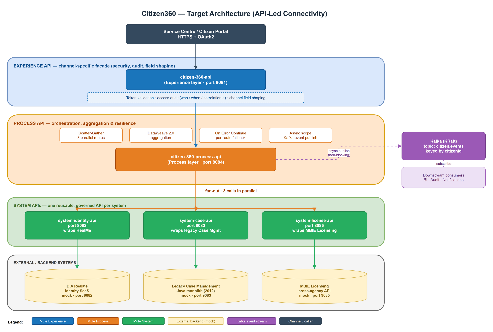

# Citizen360 — API-Led Mule 4 Integration

An end-to-end MuleSoft integration project built to demonstrate the **full delivery
lifecycle** of a real enterprise API programme — from contract-first API design on
Anypoint Platform, through API-led development in Anypoint Studio, to event-driven
streaming and automated testing.

**The business scenario:** a fictional government agency (Ministry of Citizen Services)
holds citizen data in three disconnected, independently owned systems — a central
identity service (RealMe), a legacy case-management platform, and a cross-agency
licensing API. Service-centre staff have to log into all three and stitch the data
together by hand. This project builds a single, governed citizen 360-view API on top
of them, plus a near-real-time event stream.

---

## What this project demonstrates

Rather than a single "hello world" flow, this is a complete, realistic MuleSoft
solution covering the skills an integration team owns across the entire engagement:

| Phase | Capability shown | Where |
|---|---|---|
| **1. Discovery & architecture** | Requirements, as-is/to-be analysis, API-led target architecture | [`docs/`](docs/) |
| **2. Contract-first design** | RAML 1.0 specs, reusable types, examples, error model | [`docs/contracts/`](docs/contracts/) |
| **3. System layer** | Wrapping legacy/SaaS backends into reusable governed APIs | `mule-apps/system-*` |
| **4. Process layer** | Orchestration, parallel aggregation, transformation, graceful degradation | `mule-apps/citizen-360-process-api-impl` |
| **5. Experience layer** | Channel-specific facade and API policy enforcement | `mule-apps/citizen-360-api-impl` |
| **6. Event-driven** | Async Kafka publishing, keyed partitioning, event schema | `infra/` |
| **7. Testing** | MUnit with mocked dependencies and assertions | `src/test/munit/` |
| **8. CI/CD & deployment** | GitHub Actions pipeline, CloudHub 2.0 descriptor | [`.github/`](.github), [`infra/cloudhub.yaml`](infra/cloudhub.yaml) |

---

## Target architecture



*Editable source: [`docs/target-architecture.drawio`](docs/target-architecture.drawio) (diagrams.net).*

The diagram shows the three API-led tiers, the external systems they wrap, the
parallel fan-out in the Process layer, and the async event stream into Kafka.

---

## Technology stack and what each piece does

### MuleSoft / Anypoint Platform
- **Mule Runtime 4.4, Anypoint Studio 7** — five deployable applications built visually and in XML.
- **APIkit** — generates REST flows and routers directly from the RAML contract, so implementation always conforms to the published spec.
- **DataWeave 2.0** — all message mapping, field shaping, and multi-source aggregation.
- **RAML 1.0 & Design Center** — contract-first design, reusable types/examples, and documentation before code.
- **HTTP Connector** — reusable request configurations with connection pooling and timeouts.
- **Scatter-Gather** — fans out to the three system APIs **in parallel**, so latency is the slowest call, not the sum.
- **Error Handler / On Error Continue** — per-route graceful degradation: one downstream failing returns fallback data with HTTP 200 instead of collapsing the whole request.
- **Async scope** — publishes a Kafka event without blocking the response to the caller.
- **MUnit / MUnit Tools** — unit tests that mock outbound HTTP calls and assert the aggregated result.
- **CloudHub 2.0** — deployment descriptor included for managed runtime deployment.

### Event-driven
- **Apache Kafka (KRaft mode)** — ZooKeeper-less broker, topic `citizen.events`, keyed by `citizen-{citizenId}` so one citizen's events stay ordered on one partition.
- **Kafka UI** — browser-based inspection of topics and messages.
- **Event schema** — JSON payload (`eventType`, `citizenId`, `timestamp`, `correlationId`, `source`).

### Supporting services & tooling
- **Spring Boot 3 / Java 17** — three independent mock backends that stand in for the real SaaS/legacy systems, so the Mule network is fully runnable and testable offline.
- **Docker Compose** — one command brings up Kafka + Kafka UI.
- **GitHub Actions** — CI pipeline for the Mule projects.
- **draw.io** — system-boundary and business-process diagrams.

---

## The delivery lifecycle, step by step

### 1. Contract-first API design
Designed every API in **RAML 1.0 before writing code** — defining endpoints, data types,
examples, and the RFC 7807 `application/problem+json` error model. The contract is the
single source of truth that APIkit uses to scaffold flows, and that consumers (front-end
teams, partners) can build against in parallel.

- [Experience API](docs/contracts/citizen-360-api.raml) — `GET /citizens/{id}/360`
- [Process API](docs/contracts/citizen-360-process-api.raml) — aggregation endpoint
- [System: Identity](docs/contracts/system-identity-api.raml) · [Case](docs/contracts/system-case-api.raml) · [License](docs/contracts/system-license-api.raml)
- External reference specs for [DIA RealMe](docs/contracts/external-dia-realme.raml) and [MBIE Licensing](docs/contracts/external-mbie-licensing.raml)

### 2. System layer — "one system, one API"
Each backend is wrapped in a dedicated System API that hides its native protocol,
idiosyncrasies, and versioning. These APIs are reusable across any future channel.

### 3. Process layer — orchestration and aggregation
The Process API fans out in parallel, normalises the three different responses, and
aggregates them into a single citizen view. Key DataWeave aggregation:

```dataweave
%dw 2.0
output application/json
---
{
  citizenId: vars.citizenId,
  identity:  payload[0].payload,
  cases:     payload[1].payload.cases default [],
  licenses:  payload[2].payload.licenses default [],
  asOf:      now()
}
```

### 4. Resilience — graceful degradation
Each Scatter-Gather route is wrapped in an **Error Handler with On Error Continue**. If,
for example, identity is unavailable, the API still returns cases and licences with a
fallback `{ "status": "UNAVAILABLE" }` marker and HTTP 200 — a partial view is more
useful than a failed call.

### 5. Event-driven streaming
After the synchronous response is assembled, an **Async** scope emits a
`CitizenViewed` event to Kafka (non-blocking). The `correlationId` is carried into the
event for end-to-end audit tracing.

### 6. Automated testing with MUnit
MUnit tests set up the inbound event (`uriParams.citizenId`), **mock every outbound HTTP
request** so the suite runs without live backends, and assert the aggregated output.
This proves the orchestration is correct in isolation and can run in CI headless.

### 7. CI/CD and deployment
A GitHub Actions pipeline builds the Mule projects, and a CloudHub 2.0 descriptor
describes the managed deployment — closing the loop from commit to runtime.

---

## Integration patterns & skills matrix

| Skill | How it's applied here |
|---|---|
| API-led connectivity | Three clearly separated tiers — System, Process, Experience |
| Contract-first design | RAML 1.0 specs authored before implementation |
| Parallel orchestration | Scatter-Gather across three dependencies |
| Data transformation | DataWeave 2.0 aggregation, defaulting, field shaping |
| Error handling | On Error Continue with per-route fallback |
| Async messaging | Non-blocking Kafka publish with partition keys |
| API resilience | Connection configs, timeouts, partial-failure semantics |
| Unit testing | MUnit mocking HTTP dependencies + assertions |
| Backend mocking | Spring Boot 3 stand-ins for SaaS/legacy systems |
| Containerisation | Docker Compose for Kafka + UI |
| CI/CD | GitHub Actions + CloudHub 2.0 descriptor |
| Architecture & docs | As-is/to-be analysis, boundary diagrams (draw.io) |

---

## Repository layout

```
mulesoft-citizen360/
├── mule-apps/                          # Mule 4 applications
│   ├── citizen-360-api-impl/           # Experience layer
│   ├── citizen-360-process-api-impl/   # Process layer + MUnit suite
│   ├── system-identity-api-impl/       # System: identity
│   ├── system-case-api-impl/           # System: cases
│   └── system-license-api-impl/        # System: licences
├── external-services/                  # Spring Boot mock backends
│   ├── external-dia-realme/
│   ├── external-case-mgmt/
│   └── external-mbie-licensing/
├── docs/                               # Delivery documentation
│   ├── 01-requirements.md
│   ├── 02-as-is.md
│   ├── 03-to-be.md
│   ├── 04-api-contracts.md
│   ├── business-process.drawio
│   └── contracts/                      # RAML 1.0 specs
├── infra/
│   ├── docker-compose.yml              # Kafka + Kafka UI
│   └── cloudhub.yaml                   # CloudHub 2.0 deployment
├── .github/workflows/mule-pipeline.yml # CI
└── pom.xml                             # Parent Maven POM
```

---

## Running locally (optional)

The project is fully runnable. Full step-by-step setup is in the docs; the short version:

1. `docker compose -f infra/docker-compose.yml up -d` — Kafka + UI (Kafka UI on `http://localhost:8090`)
2. Run the three Spring Boot mocks from `external-services/` (ports 9082/9083/9085)
3. Import the five `mule-apps/*` projects into Anypoint Studio and run them
4. `GET http://localhost:8081/api/citizens/RN-12345/360` returns the aggregated view;
   a `CitizenViewed` event appears in Kafka

Sample citizens: `RN-12345` (verified / LOW risk), `RN-22222` (MEDIUM), `RN-33333` (HIGH, no cases or licences).
